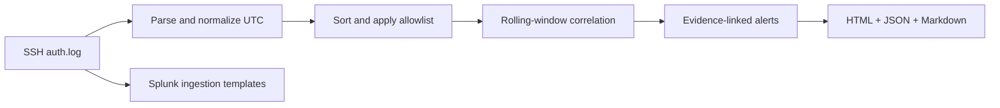

# Brute Force Attack Detection & Investigation

A reproducible SOC portfolio lab that turns OpenSSH authentication logs into evidence-linked detections, an interactive HTML report, and an investigation record. Built with **Python standard library only**.

**Lab status:** the Python demo and automated tests run locally. The bundled data is synthetic. Splunk searches are deployment templates, not evidence of a live SIEM deployment. No attack traffic is generated and no containment actions are executed.

## Run in 30 seconds

Requires Python 3.9 or newer. From this project directory:

```bash
python3 -m bruteforce --input data/auth.log --output reports/local --label "Synthetic SSH lab"
python3 -m unittest discover -s tests -v
```

On Windows, use `py` in place of `python3`. Open `reports/local/dashboard.html` in a browser. No packages, account, server, or API key is required.

To clone the published project:

```bash
git clone https://github.com/yugjariya/soc-learning-journey.git
cd soc-learning-journey/projects/brute-force-detection
```

Expected demo output:

```text
Parsed 27 authentication events; 4 alerts.
Skipped 1 unrelated lines; 0 malformed authentication lines.
```

## What it detects

| Detection | Default rule | Investigation priority |
| --- | --- | --- |
| Repeated failures | At least 5 failures for one host/source/account within 5 minutes | High |
| Password-spray pattern | At least 5 distinct accounts fail from one source against one host within 5 minutes | High |
| Distributed attempts | At least 5 failures across at least 3 sources against one account/host within 5 minutes | High |
| Success after a burst | Successful login for the same host/source/account within 10 minutes after a qualifying failure-window endpoint | Critical |

The engine uses inclusive rolling windows, sorts events by timestamp and original line number, and groups consecutive qualifying windows into episodes. Evidence is the union of records in those windows: an episode can span longer than five minutes. One record can support multiple types of finding, so alert failure counts must not be added to obtain total input failures.

A spray pattern cannot establish that the same password was reused. A successful login cannot establish compromise. Multiple addresses cannot establish that one actor controls them. The priorities are lab defaults for analyst triage.

## Reproduced findings

The sample contains **28 lines, 27 authentication events, 22 failures, 5 successes, and 6 source addresses** on `gateway-01`.

| Scenario | Evidence in `data/auth.log` | Result |
| --- | --- | --- |
| Admin password guessing | Lines 6–13: 8 failures from `203.0.113.10` | Repeated-failures alert |
| Follow-up public-key login | Line 14: admin success from the same source | Suspicious-success alert; validate key ownership |
| Account sweep | Lines 15–20: 6 users from `198.51.100.23` | Spray-pattern alert |
| Distributed account targeting | Lines 21–26: service account, 3 source addresses | Distributed-attempts alert |
| Ordinary logins and typing mistakes | Lines 1–5 and 27 | No alert |

Read the [case study](docs/CASE_STUDY.md), [generated investigation](reports/sample/investigation.md), and [response playbook](docs/PLAYBOOK.md). The [sample HTML dashboard](reports/sample/dashboard.html) can be downloaded and opened locally; GitHub displays its source code.

## Output files

| File | Contents |
| --- | --- |
| `dashboard.html` | Offline report with failure timeline, severity filters, and expandable evidence |
| `alerts.json` | Findings, configuration, input SHA-256, coverage counts, UTC intervals |
| `events.jsonl` | Normalized events with original log text and physical line numbers |
| `investigation.md` | Human-readable findings and conditional response recommendations |



## Analyze your own logs

Keep private logs under the ignored `private_logs/` directory and generated results under `reports/local/`.

```bash
python3 -m bruteforce --input private_logs/auth.log --output reports/local \
  --year 2026 --timezone=+05:30 --threshold 8 --window-seconds 300

python3 -m bruteforce --input data/auth.log --output reports/local \
  --allow 192.0.2.0/24 --spray-users 5 --distributed-sources 3
```

Use `--timezone=-05:00` for negative offsets. ISO timestamps with explicit offsets retain their own timezone. Yearless and timezone-less timestamps use the supplied assumptions. The default year is the current UTC year; the default offset is UTC. Split yearless logs across year boundaries before analysis.

Supported messages: OpenSSH `Failed password`, `Accepted password`, and `Accepted publickey`, including invalid-user failures, IPv4/IPv6, `sshd`/`sshd-session`, ISO timestamps, and traditional `Oct 20 09:03:00` timestamps. Other message types are counted as skipped. Recognizable but broken supported authentication records are counted as malformed. This is not an EVTX, PAM, VPN, or cloud-identity parser.

Use `--fail-on-alert` for exit status **1** when detections are present. A successful analysis otherwise exits **0**; input/configuration errors exit **2**. Outputs in the selected directory are replaced on each run. The input file is not modified.

## SIEM workflow

[Splunk setup and searches](siem/README.md) provide ingestion configuration and rolling-window searches for the same SSH log format. Validate them in your own Splunk environment before scheduling alerts. The local dashboard is a batch report, not a connected SIEM console.

## Verification and limitations

Automated tests cover time-window boundaries, benign activity, unsorted input, separated bursts, cross-host isolation, IPv6 allowlisting, malformed records, success correlation, CLI errors, report generation, and HTML escaping. The included GitHub Actions workflow runs the suite on Python 3.9, 3.12, and 3.13 when installed at the repository root.

- Input records are held in memory; this is a learning project, not a production streaming pipeline.
- Duplicate log records count separately; deduplicate upstream.
- Low-and-slow attacks below thresholds, unsupported authentication methods, and missing logs can evade detection.
- Shared NAT/VPN sources, stale automation credentials, and legitimate user mistakes can cause false positives.
- Summary counters include allowlisted sources; detections exclude them.
- Raw evidence may contain sensitive account and host information. The committed fixture contains documentation-only IP ranges and invented accounts.

Regenerate the fixture with `python3 scripts/generate_sample.py` and rerun the analyzer. No network connection is used by either command.

## Project structure

```text
bruteforce/               Parser, detector, CLI, report renderer
data/auth.log            Deterministic synthetic evidence
docs/                    Case study, investigation playbook, references
reports/sample/          Reproduced demo results
scripts/generate_sample.py
siem/                    Splunk configuration and searches
tests/                   Standard-library unit and integration tests
.github/workflows/       Standalone repository CI workflow
```

## Portfolio description

> Built a Python authentication-log analysis lab to detect repeated login failures, password-spray patterns, distributed attempts, and success after a failure burst. Produced evidence-linked reports and containment recommendations, and developed Splunk search templates for SIEM integration using synthetic SSH data.

Describe the SIEM monitoring as deployed only after you ingest the logs and validate the searches in a running SIEM. See [references](docs/REFERENCES.md) for the supporting documentation.

MIT licensed; see [LICENSE](LICENSE).
